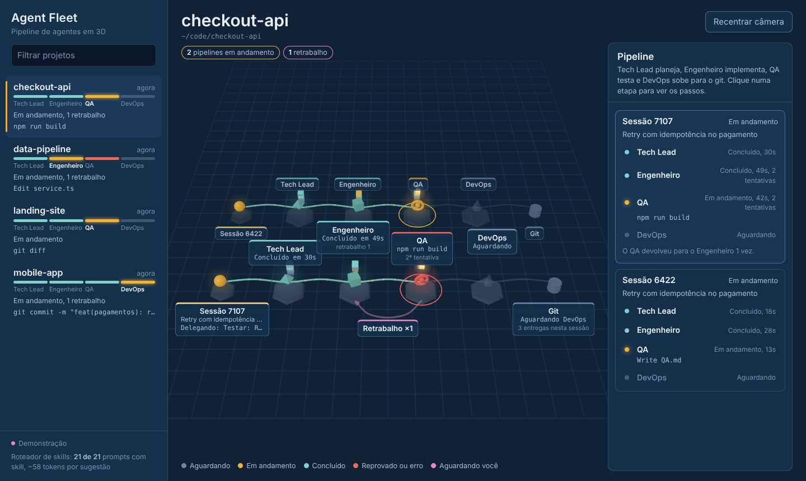
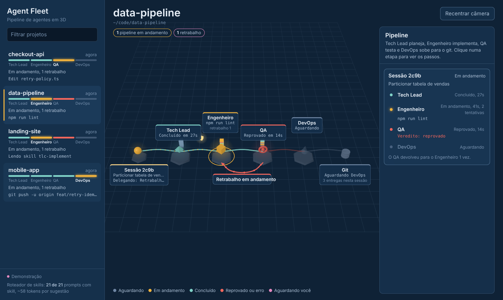
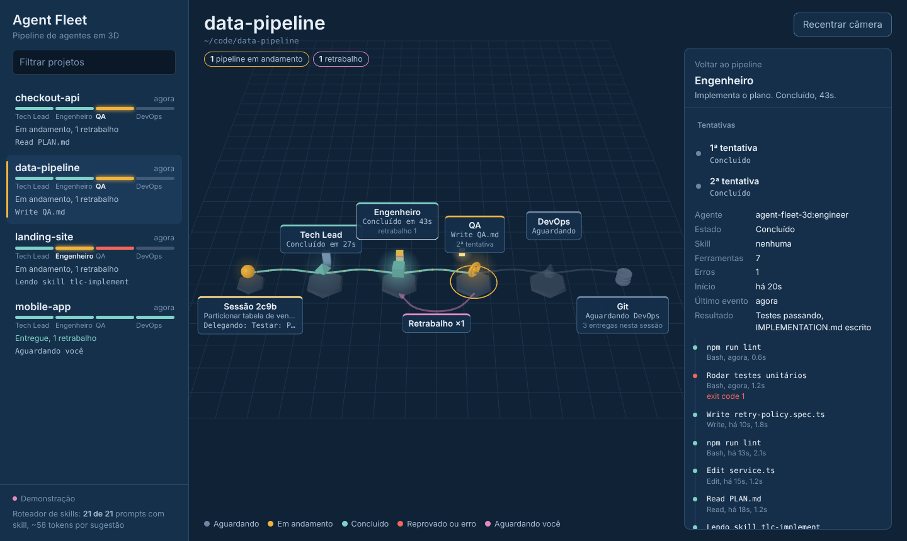
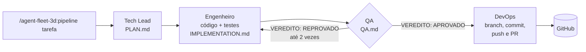
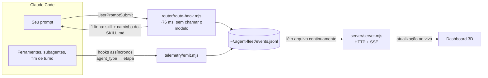
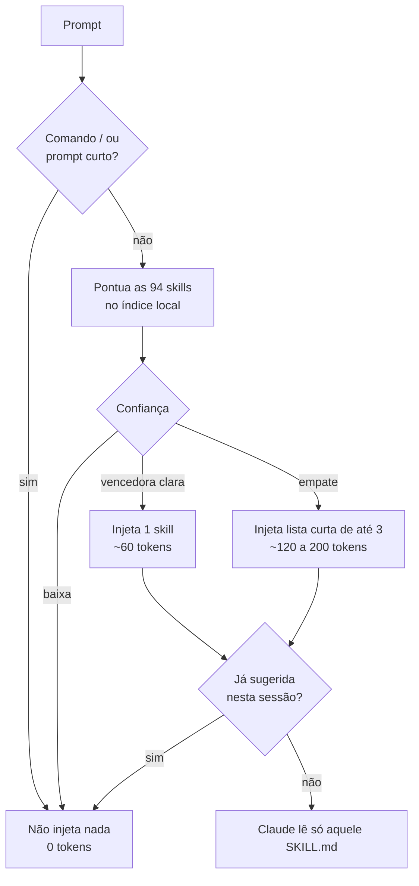

<div align="center">

# Agent Fleet 3D

**Passe cada tarefa por um time de agentes — Tech Lead, Engenheiro, QA e DevOps — e acompanhe o fluxo em 3D, ao vivo.**
<br/>
**Cada etapa usa as skills do Tech Leads Club, escolhidas sem pagar o catálogo inteiro em tokens.**


 


[Instalar](#instalação) · [Usar](#uso) · [Pipeline](#o-pipeline) · [Como funciona](#como-funciona) · [Roteador de skills](#roteador-de-skills) · [Visualizações](#visualizações) · [Desenvolvimento](#desenvolvimento)

</div>

---

## O que é

Um plugin do Claude Code com três partes que trabalham juntas:

| | O que faz |
| --- | --- |
| **Pipeline de agentes** | `/agent-fleet-3d:pipeline <tarefa>` passa a tarefa por quatro agentes em sequência: o **Tech Lead** planeja, o **Engenheiro** implementa, o **QA** testa e o **DevOps** sobe para o git. Se o QA reprovar, a tarefa volta para o Engenheiro, até duas vezes. |
| **Dashboard 3D** | À esquerda, os projetos com agentes trabalhando agora e a barra de progresso de cada pipeline. Ao clicar num projeto, o fluxo aparece em 3D: as quatro estações ligadas por uma esteira, o pacote de trabalho parado na etapa atual e o passo que o agente está executando. |
| **Roteador de skills** | As 94 skills do [Tech Leads Club](https://agent-skills.techleads.club/skills/) ficam no plugin. Cada agente do pipeline usa as dele, e nos seus pedidos comuns um índice local escolhe a skill certa. Carregar o catálogo inteiro custaria cerca de 12.700 tokens por sessão; uma sugestão custa de 60 a 200, e nada quando nenhuma skill se aplica. |

Tudo roda na sua máquina. Nenhum dado sai do seu computador.

## Prints

<table>
  <tr>
    <td width="50%"></td>
    <td width="50%"></td>
  </tr>
  <tr>
    <td><b>Fluxo.</b> Uma linha por sessão. A esteira acende conforme as etapas avançam, e o pacote de trabalho fica sobre a estação ativa.</td>
    <td><b>Retrabalho.</b> Quando o QA reprova, a estação fica vermelha e o caminho no chão leva a tarefa de volta ao Engenheiro.</td>
  </tr>
  <tr>
    <td></td>
    <td></td>
  </tr>
  <tr>
    <td><b>Detalhe da etapa.</b> Tentativas, skill usada, resultado e cada passo com a duração.</td>
    <td><b>Tema claro.</b> Segue a preferência do sistema.</td>
  </tr>
</table>

> [!TIP]
> Quer ver antes de instalar? Baixe [`docs/demo.html`](docs/demo.html) e abra no navegador. A demo roda sozinha com pipelines simulados.

## Instalação

**Requisito:** [Node.js](https://nodejs.org) 18 ou mais, instalado no computador. Não há `npm install`; o three.js já vem embutido.

**No app do Claude (Windows ou Mac)**
1. Baixe o zip do plugin: no GitHub, **Code → Download ZIP**. O zip baixado já serve para o upload.
2. Vá em **Personalizar → Plugins → Adicionar → Upload plugin** e escolha o zip.
3. Feche e abra o app. O plugin funciona na aba **Code**, numa sessão local.

**No Claude Code (terminal)**

```bash
/plugin marketplace add carloscjm/agent-fleet-3d
/plugin install agent-fleet-3d@agent-fleet-3d
```

Para conferir: ao digitar `/` aparecem `agent-fleet-3d:pipeline`, `agent-fleet-3d:fleet` e `agent-fleet-3d:find-skill`.

## Uso

### 1. Abra o dashboard

```
/agent-fleet-3d:fleet
```

O navegador abre o dashboard, normalmente em `http://localhost:4317`. Use `/agent-fleet-3d:fleet demo` para ver com dados simulados.

### 2. Rode uma tarefa pelo pipeline

```
/agent-fleet-3d:pipeline adicionar endpoint /health com teste
```

O projeto aparece na lista assim que o Tech Lead começa. Os agentes trocam o trabalho por arquivos numa pasta `.agent-pipeline/<tarefa>/` no projeto, que fica fora do git.

### 3. Leia a cena

| Na cena | Significa |
| --- | --- |
| Estação apagada | Etapa ainda não começou |
| Estação âmbar girando, com anel | Etapa em andamento; o cartão mostra o passo atual |
| Estação turquesa | Etapa concluída; o cartão mostra quanto tempo levou |
| Estação vermelha e caminho no chão | QA reprovou; a tarefa volta para o Engenheiro |
| Estação ou sessão rosa piscando | O agente está esperando você no app |
| Pilha de placas atrás da estação | Os últimos passos da etapa, coloridos pelo tipo de ferramenta |
| Repositório turquesa no fim | DevOps terminou: commit enviado e PR aberto |

Clique numa estação, na cena ou no painel da direita, para ver as tentativas e os passos daquela etapa. `Esc` volta. Arraste para girar a câmera, use a roda do mouse para zoom e **Recentrar câmera** para voltar ao enquadramento.

### Comandos

| Comando | O que faz |
| --- | --- |
| `/agent-fleet-3d:pipeline <tarefa>` | Executa a tarefa pelo Tech Lead → Engenheiro → QA → DevOps |
| `/agent-fleet-3d:fleet` | Abre o dashboard |
| `/agent-fleet-3d:fleet demo` | Abre o dashboard com dados simulados |
| `/agent-fleet-3d:find-skill <tarefa>` | Pergunta ao roteador qual skill usar e aplica |

## O pipeline



| Agente | Faz | Skills do Tech Leads Club | Não faz |
| --- | --- | --- | --- |
| **Tech Lead** | Lê o código relevante e escreve o `PLAN.md`: objetivo, tarefas pequenas, critérios de aceite com valores concretos e os comandos de teste | `tlc-plan`, `tlc-spec-lean` em features maiores, `create-adr` em decisões difíceis de reverter | Não escreve código de produto |
| **Engenheiro** | Implementa o plano, escreve testes, roda testes, lint e build e registra tudo no `IMPLEMENTATION.md`. No retrabalho, corrige cada falha do `QA.md` | `tlc-implement`, `coding-guidelines` | Não faz commit nem push |
| **QA** | Verifica cada critério com evidência, roda os testes por conta própria, lê o `git diff`, procura segredos e testes desativados, e termina com `VEREDITO: APROVADO` ou `REPROVADO` | `spec-driven-eval`, `playwright-skill` quando há interface web | Não corrige código |
| **DevOps** | Só com QA aprovado: cria a branch, faz commit no padrão Conventional Commits, envia e abre o PR com `gh` | `gh-fix-ci` se o CI falhar depois | Nunca força push nem envia direto para `main` |

O orquestrador passa só o caminho da pasta de uma etapa para a outra, nunca o relatório inteiro, para gastar menos tokens. O DevOps roda no modelo Haiku, que é mais barato, porque o trabalho dele é mecânico.

## Como funciona



1. **Coleta.** Hooks do Claude Code gravam um evento compacto a cada ação: sessão, subagente, ferramenta e um resumo legível do passo (`Edit checkout.ts`, `Rodar testes`, `Delegando: mapear módulos`). Eles rodam em segundo plano e não atrasam o agente.
2. **Projeto.** O projeto é a raiz git mais próxima da pasta onde o agente está.
3. **Estado.** Um reducer (`shared/fleet-core.mjs`) transforma eventos em agentes com estado. Cada subagente do tipo `tech-lead`, `engineer`, `qa` ou `devops` vira uma etapa do pipeline daquela sessão; o veredito do QA é lido da última mensagem dele. O mesmo código roda no servidor e no navegador.
4. **Tela.** O servidor envia as mudanças por SSE; a cena 3D é desenhada com three.js.

<details>
<summary><b>Exemplo de evento gravado</b></summary>

```json
{
  "t": 1792378255386,
  "e": "PreToolUse",
  "sid": "11111111-2222",
  "aid": "ag1",
  "at": "Explore",
  "proj": { "id": "08a36877fd", "name": "checkout-api", "root": "/home/carlos/code/checkout-api" },
  "tool": "Grep",
  "tuid": "t3",
  "step": "Grep \"<form\""
}
```

</details>

<details>
<summary><b>Regras de estado</b></summary>

- Um projeto fica na lista enquanto tiver agente ativo ou atividade na última hora.
- Um agente sem eventos há 15 minutos aparece como **sem atividade**.
- Uma nova execução do pipeline começa quando o Tech Lead é chamado de novo depois que outras etapas já rodaram.
- A cena mostra até 4 sessões do projeto, uma por linha; as demais aparecem no painel.
- Subagentes fora do pipeline aparecem como pontos ao lado da sessão e saem 2 minutos depois de terminar.
- Cada agente guarda os últimos 40 passos; cada estação mostra os 8 mais recentes.
- O arquivo de eventos é rotacionado em 20 MB.

</details>

## Roteador de skills

### O problema

Skills nativas do Claude Code colocam a descrição de cada skill no contexto de **todas** as sessões. Com as 94 skills da TLC, isso daria cerca de **12.700 tokens fixos**, mesmo numa conversa que não usa nenhuma.

### A solução

As skills ficam em `skills-library/`, fora do carregamento automático. A cada prompt, um hook decide **fora do modelo** se alguma skill se aplica:



A pontuação combina:

- **BM25** sobre nome, descrição, cláusula *"Use when…"* e títulos de cada SKILL.md;
- **frases‑gatilho** que o próprio autor da skill escreveu entre aspas;
- **pares de termos** que aparecem juntos na descrição;
- **menção explícita** ao nome da skill;
- as regras **"Do NOT use for X (use Y)"** de cada skill, que viram penalidades e redirecionamentos;
- **português → inglês**, por um dicionário de sinônimos (`router/synonyms-pt.json`).

### Exemplos reais

```text
$ node router/route-cli.mjs "crie um ADR registrando por que escolhemos Postgres"

Skill router: the "create-adr" skill matches this request. Its instructions are at
${CLAUDE_PLUGIN_ROOT}/skills-library/creation/create-adr/SKILL.md (read that file only;
open its references/ files only if a step needs them).

(single, ~58 tokens injected)
   20.31  create-adr        [creation]
    3.15  harness-eval      [development]
    2.36  subagent-creator  [creation]
```

```text
$ node router/route-cli.mjs "decompor o monolito em módulos por domínio"

(shortlist, ~196 tokens injected)
   24.20  modular-decomposition              [architecture]
   22.17  nestjs-modular-monolith            [development]
   17.85  evolutionary-modular-architecture  [architecture]
```

```text
$ node router/route-cli.mjs "obrigado, valeu!"

Skill router: no skill clearly matches; proceed without one.
(none, ~0 tokens injected)
```

### Resultados

Medido com `npm test` sobre 49 prompts em português e inglês (`test/cases.json`):

| Métrica | Valor |
| --- | --- |
| Skill certa em primeiro lugar | **98%** |
| Skill certa dentro da lista curta | **100%** |
| Custo médio por sugestão | **~72 tokens** |
| Tempo por prompt (incluindo a partida do Node) | **~76 ms** |
| Custo de carregar o catálogo inteiro, para comparação | ~12.700 tokens por sessão |

<details>
<summary><b>As 94 skills incluídas, por categoria</b></summary>

| Categoria | Skills | Exemplos |
| --- | --- | --- |
| Development | 19 | `tlc-spec-driven`, `tlc-prd`, `docs-writer`, `jira-assistant`, `react-native-expert` |
| Go-to-Market | 18 | `ai-pricing`, `ai-cold-outreach`, `positioning-icp`, `gtm-metrics` |
| Architecture | 14 | `modular-decomposition`, `coupling-analysis`, `tactical-ddd`, `legacy-migration-planner` |
| Tooling | 8 | `mermaid-studio`, `excalidraw-studio`, `gh-fix-ci`, `chrome-devtools` |
| Quality | 7 | `the-judge`, `web-accessibility`, `seo`, `web-quality-audit` |
| Skill & Agent Creation | 6 | `create-adr`, `create-rfc`, `skill-architect`, `subagent-creator` |
| Cloud & Infrastructure | 5 | `aws-advisor`, `vercel-deploy`, `netlify-deploy`, `cloudflare-deploy` |
| Design | 4 | `frontend-design`, `figma-implement-design`, `web-design-guidelines` |
| Performance | 4 | `core-web-vitals`, `perf-lighthouse`, `perf-astro` |
| Security | 3 | `security-best-practices`, `security-threat-model`, `security-ownership-map` |
| Decision Making | 2 | `the-fool`, `the-jury` |
| Web Automation | 2 | `playwright-skill`, `demo` |
| Learning & Growth | 1 | `learning-opportunities` |
| Monitoring | 1 | `sentry` |

Catálogo completo: [agent-skills.techleads.club/skills](https://agent-skills.techleads.club/skills/)

</details>

<details>
<summary><b>Como melhorar o roteamento</b></summary>

1. Adicione o prompt que falhou em `test/cases.json`, com a skill esperada.
2. Se for vocabulário em português, inclua o termo em `router/synonyms-pt.json`.
3. Rode `npm run build:index` e `npm test`.

O teste falha se a acurácia ficar abaixo de 90%.

</details>

## Visualizações

A visão atual é o **fluxo**: estações em sequência, ligadas por uma esteira, uma linha por sessão. A visão anterior em órbitas foi substituída por ela. Todas as visões usam os mesmos dados, então adicionar uma nova não mexe na coleta.

Próximas propostas, detalhadas em [docs/visualizacoes.md](docs/visualizacoes.md):

- [ ] **Linha do tempo do pipeline**, com a duração de cada etapa e de cada retrabalho, para achar gargalos
- [ ] **Grafo de forças 3D** ligando agentes, arquivos e skills, mostrando quando dois agentes mexem no mesmo arquivo
- [ ] **Cidade isométrica** com um prédio por projeto, para ver muitos pipelines de uma vez
- [ ] **Mapa de calor do repositório**, mostrando onde no código os agentes estão mexendo

## Configuração

| Variável | Padrão | Efeito |
| --- | --- | --- |
| `AGENT_FLEET_HOME` | `~/.agent-fleet` | Onde ficam os eventos e o cache do roteador |
| `AGENT_FLEET_PORT` | `4317` | Porta do dashboard |
| `AGENT_FLEET_REDACT_PROMPTS` | vazio | Se definida, o texto dos seus prompts não é gravado |

## Desenvolvimento

```bash
git clone https://github.com/carloscjm/agent-fleet-3d && cd agent-fleet-3d

npm run demo          # dashboard com dados simulados
npm test              # roteador (acurácia) + estado dos agentes
npm run route -- "sua tarefa aqui"
npm run build:index   # reconstrói router/index.json
npm run build:demo    # gera docs/demo.html
npm run sync:skills   # baixa a versão mais nova das skills da TLC
```

<details>
<summary><b>Estrutura de pastas</b></summary>

```
.claude-plugin/    plugin.json e marketplace.json
hooks/hooks.json   roteador (síncrono) + telemetria (assíncrona)
agents/            tech-lead, engineer, qa e devops
skills/            pipeline, fleet, find-skill e skill-router
skills-library/    94 skills do Tech Leads Club, por categoria
router/            índice, pontuação, hook e CLI
telemetry/         captura de eventos dos hooks
shared/            reducer de estado + gerador de demo
server/            servidor HTTP + SSE sem dependências
ui/                dashboard (three.js embutido em ui/vendor)
docs/              demo autônoma, prints e propostas de visualização
test/              testes com node --test
```

</details>

## Solução de problemas

<details>
<summary><b>O dashboard abre, mas nenhum projeto aparece</b></summary>

Veja se `~/.agent-fleet/events.jsonl` cresce enquanto o agente trabalha. Se não crescer, os hooks não estão rodando: confira `/hooks` no Claude Code e se o `node` está no PATH do terminal onde o Claude Code foi aberto.

</details>

<details>
<summary><b>A porta 4317 está ocupada</b></summary>

```bash
AGENT_FLEET_PORT=4400 node server/server.mjs --open
```

</details>

<details>
<summary><b>O fluxo não aparece, só a sessão principal</b></summary>

As estações acendem quando os subagentes `tech-lead`, `engineer`, `qa` e `devops` rodam, então use `/agent-fleet-3d:pipeline`. Separar os passos por subagente depende dos campos `agent_id` e `agent_type` que o Claude Code envia nos hooks; versões antigas não enviam, então atualize o Claude Code.

</details>

<details>
<summary><b>A skill sugerida não foi a ideal</b></summary>

O roteador é lexical: entende bem pedidos que usam o vocabulário das skills e menos bem pedidos muito indiretos. Em caso de dúvida ele oferece uma lista curta ou não sugere nada. Use `/agent-fleet-3d:find-skill <tarefa>` para forçar uma busca, ou cite o nome da skill no pedido. Veja também [como melhorar o roteamento](#roteador-de-skills).

</details>

## Créditos e licença

- Skills em `skills-library/`: © [Tech Leads Club](https://github.com/tech-leads-club/agent-skills), licença MIT ([LICENSE-TLC](skills-library/LICENSE-TLC)). O commit de origem fica em `skills-library/.source-commit`.
- [three.js](https://threejs.org): © autores do three.js, licença MIT.
- Restante do projeto: [MIT](LICENSE) © Carlos.
