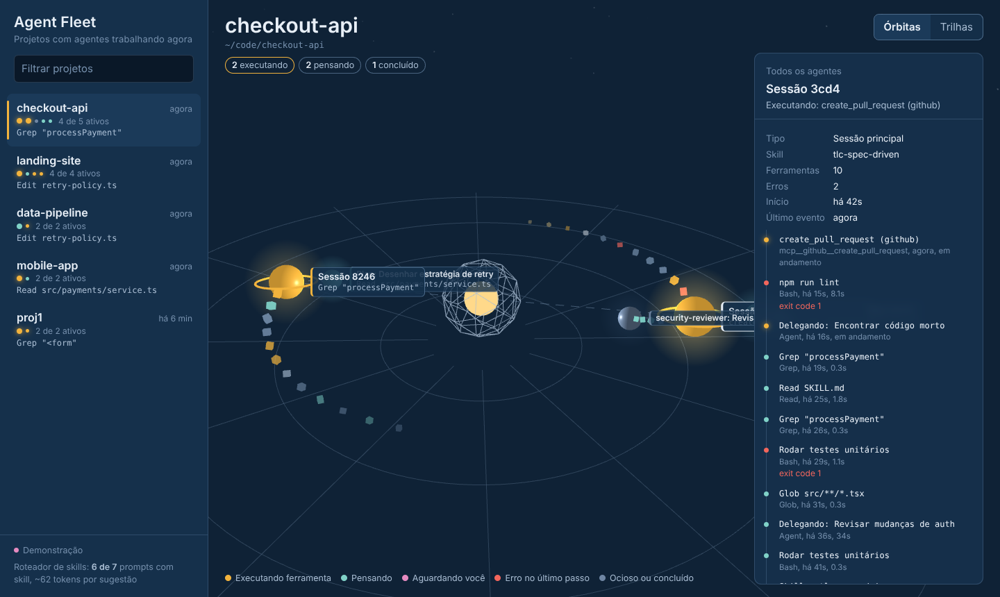
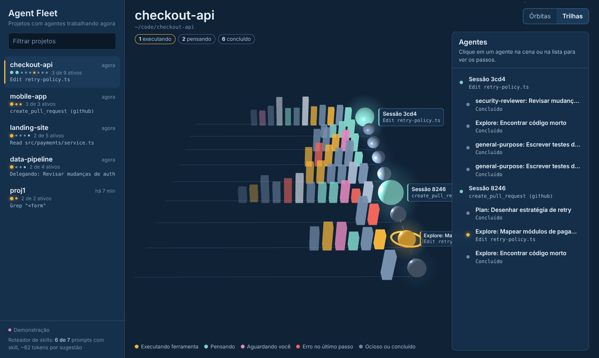
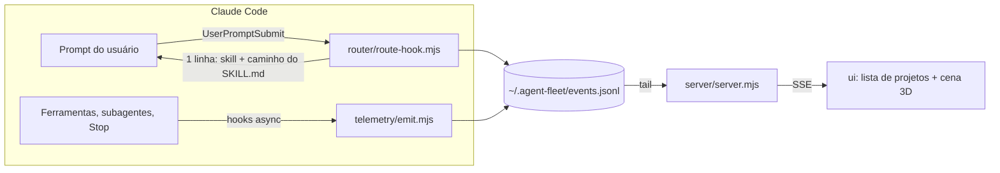

# Agent Fleet 3D

Plugin do Claude Code que mostra, em tempo real, **quais projetos têm agentes trabalhando** (coluna à esquerda) e, ao clicar em um projeto, **os agentes em 3D com o passo que cada um está executando**. Inclui as **94 skills do [Tech Leads Club](https://agent-skills.techleads.club/skills/)** e um **roteador local** que envia cada pedido para a skill certa gastando o mínimo de tokens.

| Órbitas | Trilhas |
| --- | --- |
|  |  |

- Demo sem instalar nada: abra `docs/demo.html` no navegador (ou publique a pasta `docs/` no GitHub Pages).
- Propostas de visualização: [docs/visualizacoes.md](docs/visualizacoes.md).

## Instalação

```bash
# no Claude Code
/plugin marketplace add <seu-usuario>/agent-fleet-3d
/plugin install agent-fleet-3d@agent-fleet-3d
```

Para desenvolver localmente: `claude --plugin-dir /caminho/para/agent-fleet-3d`.

Requisitos: Node 18+. Sem dependências npm; o three.js vai embutido em `ui/vendor/` para funcionar offline.

## Uso

| Comando | O que faz |
| --- | --- |
| `/agent-fleet-3d:fleet` | Sobe o dashboard em `http://localhost:4317` e abre o navegador |
| `/agent-fleet-3d:fleet demo` | Mesmo dashboard com dados simulados |
| `/agent-fleet-3d:skill <tarefa>` | Pergunta ao roteador qual skill usar |
| `npm run demo` | Dashboard com dados simulados, fora do Claude Code |
| `npm test` | Testes do roteador (acurácia) e do estado dos agentes |
| `npm run sync:skills` | Atualiza as skills a partir do repositório da TLC e reconstrói o índice |

No dashboard: clique em um projeto, depois em um agente (na cena ou na lista à direita) para ver a linha do tempo de passos. **Órbitas** mostra hierarquia e estado; **Trilhas** mostra ritmo e duração dos passos. Esc volta para a lista de agentes.

## Como funciona



**Telemetria.** Hooks assíncronos (`async: true`, não atrasam o agente) gravam um evento compacto por ação: sessão, subagente (`agent_id`/`agent_type`), ferramenta e um resumo legível do passo (`Edit checkout.ts`, `Rodar testes`, `Delegando: …`). O projeto é a raiz git mais próxima do `cwd`. Tudo fica local, em `~/.agent-fleet/` (rotação em 20 MB).

**Estado.** `shared/fleet-core.mjs` é um reducer isomórfico (roda no servidor e no navegador) que transforma eventos em agentes com estado `executando`, `pensando`, `aguardando você`, `erro`, `ocioso`, `concluído` ou `sem atividade` (15 min sem eventos). Projetos ficam na lista enquanto houver agente vivo ou atividade na última hora; subagentes concluídos saem da cena após 2 min.

## Roteador de skills: por que gasta tão pouco

Carregar as 94 skills como skills nativas colocaria todas as descrições no contexto de **toda** sessão: cerca de **12.700 tokens** fixos. Aqui elas ficam em `skills-library/` (fora do carregamento automático) e o roteamento é feito **fora do modelo**:

1. `scripts/build-index.mjs` monta um índice offline (`router/index.json`, 172 KB) a partir do frontmatter de cada SKILL.md: nome, frases-gatilho entre aspas, cláusula "Use when…", títulos e as regras "Do NOT use for X (use Y)" de cada autor.
2. A cada prompt, o hook pontua o texto com BM25 + gatilhos + pares de termos adjacentes + menção explícita ao nome da skill, aplicando os redirecionamentos e exclusões declarados pelas próprias skills. Português é mapeado para os termos em inglês (`router/synonyms-pt.json`).
3. Decide entre: **nada** (conversa comum, comando `/`, baixa confiança), **uma skill** (vencedora clara) ou **lista curta de até 3**. Injeta só uma linha com o caminho do SKILL.md; o modelo lê esse arquivo e abre `references/` apenas se precisar.
4. A mesma skill não é sugerida duas vezes na mesma sessão (zera após `/clear` ou compactação).

Resultados em `test/cases.json` (49 prompts em PT e EN): **98% de acerto top-1, 100% com a skill certa na lista curta, ~72 tokens por sugestão**, ~76 ms por prompt incluindo a partida do Node. Para melhorar o roteamento, adicione casos em `test/cases.json` e sinônimos em `router/synonyms-pt.json`, depois rode `npm test`.

## Configuração

| Variável | Padrão | Efeito |
| --- | --- | --- |
| `AGENT_FLEET_HOME` | `~/.agent-fleet` | Onde ficam eventos e cache do roteador |
| `AGENT_FLEET_PORT` | `4317` | Porta do dashboard |
| `AGENT_FLEET_REDACT_PROMPTS` | vazio | Se definido, não grava o texto dos prompts |

## Estrutura

```
.claude-plugin/   plugin.json e marketplace.json
hooks/hooks.json  roteador (síncrono) + telemetria (assíncrona)
commands/         /fleet e /skill
skills/           skill-router (fallback manual do roteador)
skills-library/   94 skills da Tech Leads Club, por categoria (MIT)
router/           índice, motor de pontuação, hook e CLI
telemetry/        captura de eventos dos hooks
shared/           reducer de estado + gerador de demo
server/           servidor HTTP + SSE sem dependências
ui/               dashboard (three.js)
docs/             demo autônoma e propostas de visualização
test/             testes (node --test)
```

## Limitações conhecidas

- Atribuir passos a subagentes depende dos campos `agent_id`/`agent_type` nos hooks, presentes nas versões recentes do Claude Code; em versões antigas tudo aparece na sessão principal.
- O roteador é lexical: entende bem pedidos que usam o vocabulário das skills, menos bem pedidos muito indiretos. Na dúvida ele oferece lista curta ou não injeta nada.

## Créditos

Skills em `skills-library/` © Tech Leads Club, licença MIT ([LICENSE-TLC](skills-library/LICENSE-TLC)); commit de origem em `skills-library/.source-commit`. three.js © autores, MIT. Restante do projeto: MIT.
