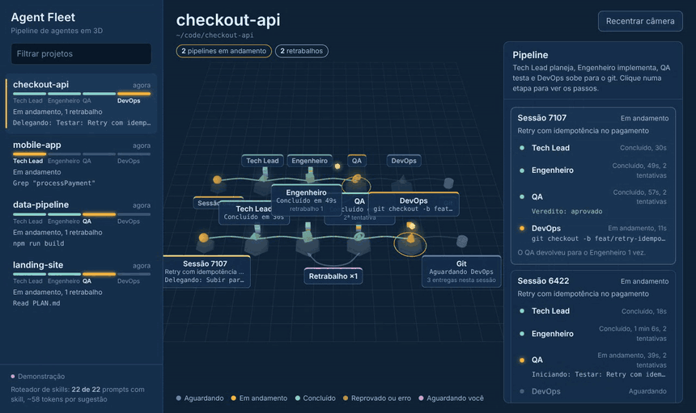
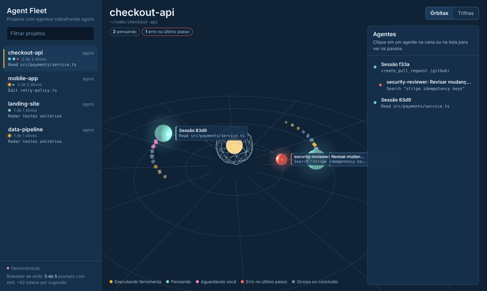
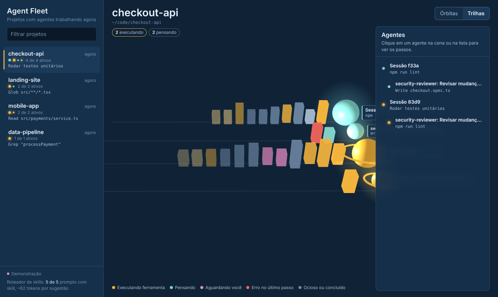
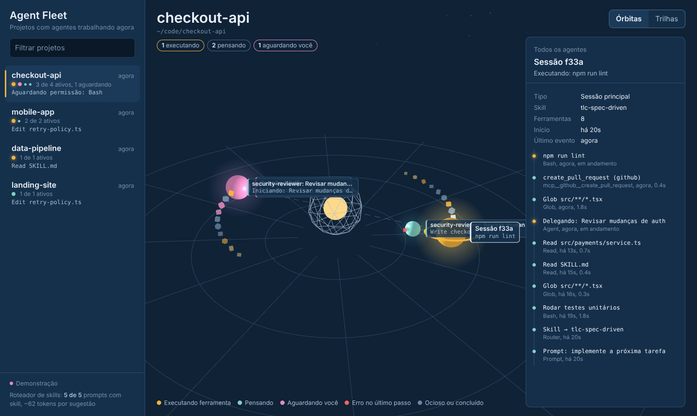
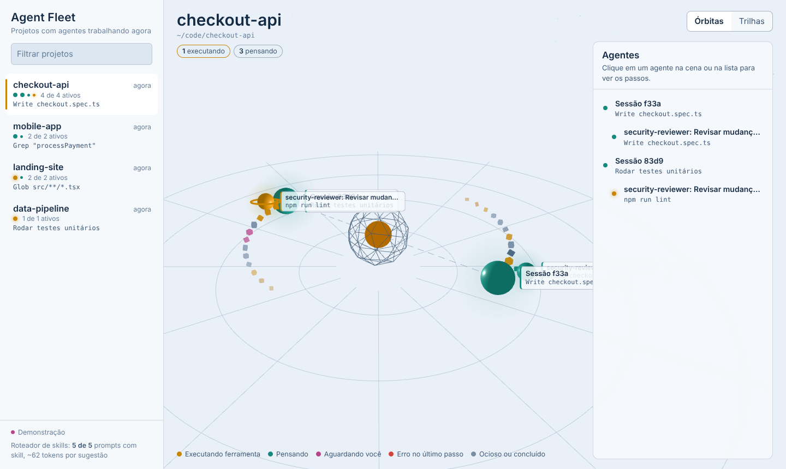
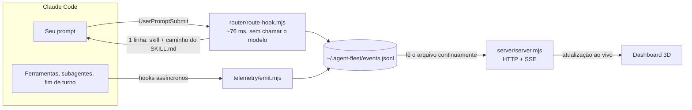
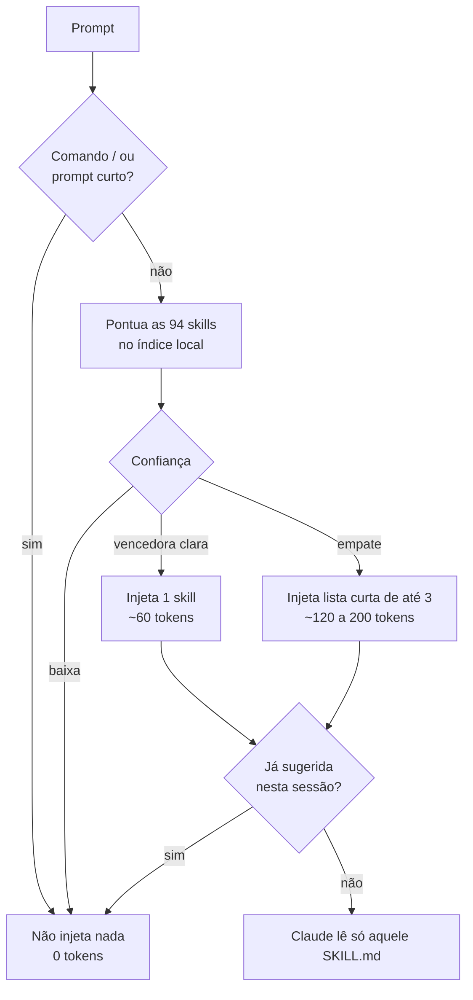

<div align="center">

# Agent Fleet 3D

**Veja em tempo real o que cada agente do Claude Code está fazendo, em todos os seus projetos.**
<br/>
**E faça cada pedido cair na skill certa sem pagar o catálogo inteiro em tokens.**


 




[Instalar](#instalação) · [Usar](#uso) · [Como funciona](#como-funciona) · [Roteador de skills](#roteador-de-skills) · [Visualizações](#visualizações) · [Desenvolvimento](#desenvolvimento)

</div>

---

## O que é

Quando você roda vários agentes ao mesmo tempo, em vários repositórios, perde de vista quem está fazendo o quê. O **Agent Fleet 3D** é um plugin do Claude Code com duas partes:

| | O que faz | Por que importa |
| --- | --- | --- |
| **Dashboard** | Coluna à esquerda com os projetos que têm agentes trabalhando agora. Clique em um projeto para ver os agentes em 3D, cada um com o passo que está executando. | Você enxerga a frota inteira de relance: quem está rodando um comando, quem está esperando sua permissão, quem errou. |
| **Roteador de skills** | Traz as 94 skills do [Tech Leads Club](https://agent-skills.techleads.club/skills/) e escolhe a skill certa para cada pedido fora do modelo, por um índice local. | Carregar todas as skills do jeito normal custaria cerca de 12.700 tokens em toda sessão. Aqui uma sugestão custa cerca de 60 a 200 tokens, e nada quando nenhuma skill se aplica. |

Tudo roda na sua máquina. Nenhum dado sai do seu computador.

## Prints

<table>
  <tr>
    <td width="50%"></td>
    <td width="50%"></td>
  </tr>
  <tr>
    <td><b>Órbitas.</b> Sessões giram em torno do projeto, subagentes em torno de quem os criou. O rastro de cubos são os últimos passos, coloridos pelo tipo de ferramenta.</td>
    <td><b>Trilhas.</b> Uma trilha por agente; cada passo vira uma barra com altura proporcional à duração. Barras altas são gargalos, vermelhas são erros.</td>
  </tr>
  <tr>
    <td></td>
    <td></td>
  </tr>
  <tr>
    <td><b>Detalhe do agente.</b> Skill em uso, número de ferramentas, erros e a linha do tempo de passos com duração.</td>
    <td><b>Tema claro.</b> Segue a preferência do sistema.</td>
  </tr>
</table>

> [!TIP]
> Quer ver antes de instalar? Baixe [`docs/demo.html`](docs/demo.html) e abra no navegador. A demo roda sozinha com dados simulados.

## Instalação

**Requisitos:** Claude Code e Node.js 18 ou mais. Não há `npm install`; o three.js já vem embutido.

```bash
# dentro do Claude Code
/plugin marketplace add carloscjm/agent-fleet-3d
/plugin install agent-fleet-3d@agent-fleet-3d
```

Reinicie o Claude Code. Para conferir: `/plugin` deve mostrar o plugin ativo e `/hooks` deve listar os hooks dele.

<details>
<summary><b>Instalar a partir de uma pasta local (para testar ou desenvolver)</b></summary>

```bash
git clone https://github.com/carloscjm/agent-fleet-3d ~/agent-fleet-3d

# só nesta sessão
cd ~/algum-projeto
claude --plugin-dir ~/agent-fleet-3d

# ou de forma permanente, dentro do Claude Code
/plugin marketplace add ~/agent-fleet-3d
/plugin install agent-fleet-3d@agent-fleet-3d
```

</details>

## Uso

### 1. Abra o dashboard

```
/agent-fleet-3d:fleet
```

O navegador abre em `http://localhost:4317`. Se preferir o terminal:

```bash
node ~/agent-fleet-3d/server/server.mjs --open
```

### 2. Trabalhe normalmente

Abra o Claude Code em um ou mais projetos e peça qualquer coisa que use ferramentas. Cada projeto entra na lista assim que um agente age. Para ver subagentes, peça algo como *"use um subagente Explore para mapear a pasta src"*.

### 3. Leia a cena

| Cor | Estado | O que significa |
| --- | --- | --- |
| 🟡 âmbar, com anel girando | **Executando** | Uma ferramenta está rodando agora (comando, edição, busca) |
| 🟢 turquesa | **Pensando** | Entre ferramentas, o modelo está raciocinando |
| 🟣 orquídea piscando | **Aguardando você** | Pediu permissão ou está esperando sua resposta |
| 🔴 coral | **Erro** | A última ferramenta falhou |
| ⚪ ardósia | **Ocioso ou concluído** | Terminou o turno, ou o subagente acabou |

Clique em um agente, na cena ou na lista da direita, para ver a linha do tempo. `Esc` volta. Arraste para girar a câmera e use a roda do mouse para dar zoom.

### Comandos

| Comando | O que faz |
| --- | --- |
| `/agent-fleet-3d:fleet` | Abre o dashboard |
| `/agent-fleet-3d:fleet demo` | Abre o dashboard com dados simulados |
| `/agent-fleet-3d:find-skill <tarefa>` | Pergunta ao roteador qual skill usar e aplica |

## Como funciona



1. **Coleta.** Hooks do Claude Code gravam um evento compacto a cada ação: sessão, subagente, ferramenta e um resumo legível do passo (`Edit checkout.ts`, `Rodar testes`, `Delegando: mapear módulos`). Eles rodam em segundo plano e não atrasam o agente.
2. **Projeto.** O projeto é a raiz git mais próxima da pasta onde o agente está.
3. **Estado.** Um reducer (`shared/fleet-core.mjs`) transforma eventos em agentes com estado. O mesmo código roda no servidor e no navegador.
4. **Tela.** O servidor envia as mudanças por SSE; a cena 3D é desenhada com three.js.

<details>
<summary><b>Exemplo de evento gravado</b></summary>

```json
{
  "t": 1792378255386,
  "e": "PreToolUse",
  "sid": "11111111-2222",
  "aid": "ag1",
  "at": "Explore",
  "proj": { "id": "08a36877fd", "name": "checkout-api", "root": "/home/carlos/code/checkout-api" },
  "tool": "Grep",
  "tuid": "t3",
  "step": "Grep \"<form\""
}
```

</details>

<details>
<summary><b>Regras de estado</b></summary>

- Um projeto fica na lista enquanto tiver agente ativo ou atividade na última hora.
- Um agente sem eventos há 15 minutos aparece como **sem atividade**.
- Subagentes concluídos saem da cena 2 minutos depois.
- Cada agente guarda os últimos 40 passos; a cena mostra os 12 mais recentes.
- O arquivo de eventos é rotacionado em 20 MB.

</details>

## Roteador de skills

### O problema

Skills nativas do Claude Code colocam a descrição de cada skill no contexto de **todas** as sessões. Com as 94 skills da TLC, isso daria cerca de **12.700 tokens fixos**, mesmo numa conversa que não usa nenhuma.

### A solução

As skills ficam em `skills-library/`, fora do carregamento automático. A cada prompt, um hook decide **fora do modelo** se alguma skill se aplica:



A pontuação combina:

- **BM25** sobre nome, descrição, cláusula *"Use when…"* e títulos de cada SKILL.md;
- **frases‑gatilho** que o próprio autor da skill escreveu entre aspas;
- **pares de termos** que aparecem juntos na descrição;
- **menção explícita** ao nome da skill;
- as regras **"Do NOT use for X (use Y)"** de cada skill, que viram penalidades e redirecionamentos;
- **português → inglês**, por um dicionário de sinônimos (`router/synonyms-pt.json`).

### Exemplos reais

```text
$ node router/route-cli.mjs "crie um ADR registrando por que escolhemos Postgres"

Skill router: the "create-adr" skill matches this request. Its instructions are at
${CLAUDE_PLUGIN_ROOT}/skills-library/creation/create-adr/SKILL.md (read that file only;
open its references/ files only if a step needs them).

(single, ~58 tokens injected)
   20.31  create-adr        [creation]
    3.15  harness-eval      [development]
    2.36  subagent-creator  [creation]
```

```text
$ node router/route-cli.mjs "decompor o monolito em módulos por domínio"

(shortlist, ~196 tokens injected)
   24.20  modular-decomposition              [architecture]
   22.17  nestjs-modular-monolith            [development]
   17.85  evolutionary-modular-architecture  [architecture]
```

```text
$ node router/route-cli.mjs "obrigado, valeu!"

Skill router: no skill clearly matches; proceed without one.
(none, ~0 tokens injected)
```

### Resultados

Medido com `npm test` sobre 49 prompts em português e inglês (`test/cases.json`):

| Métrica | Valor |
| --- | --- |
| Skill certa em primeiro lugar | **98%** |
| Skill certa dentro da lista curta | **100%** |
| Custo médio por sugestão | **~72 tokens** |
| Tempo por prompt (incluindo a partida do Node) | **~76 ms** |
| Custo de carregar o catálogo inteiro, para comparação | ~12.700 tokens por sessão |

<details>
<summary><b>As 94 skills incluídas, por categoria</b></summary>

| Categoria | Skills | Exemplos |
| --- | --- | --- |
| Development | 19 | `tlc-spec-driven`, `tlc-prd`, `docs-writer`, `jira-assistant`, `react-native-expert` |
| Go-to-Market | 18 | `ai-pricing`, `ai-cold-outreach`, `positioning-icp`, `gtm-metrics` |
| Architecture | 14 | `modular-decomposition`, `coupling-analysis`, `tactical-ddd`, `legacy-migration-planner` |
| Tooling | 8 | `mermaid-studio`, `excalidraw-studio`, `gh-fix-ci`, `chrome-devtools` |
| Quality | 7 | `the-judge`, `web-accessibility`, `seo`, `web-quality-audit` |
| Skill & Agent Creation | 6 | `create-adr`, `create-rfc`, `skill-architect`, `subagent-creator` |
| Cloud & Infrastructure | 5 | `aws-advisor`, `vercel-deploy`, `netlify-deploy`, `cloudflare-deploy` |
| Design | 4 | `frontend-design`, `figma-implement-design`, `web-design-guidelines` |
| Performance | 4 | `core-web-vitals`, `perf-lighthouse`, `perf-astro` |
| Security | 3 | `security-best-practices`, `security-threat-model`, `security-ownership-map` |
| Decision Making | 2 | `the-fool`, `the-jury` |
| Web Automation | 2 | `playwright-skill`, `demo` |
| Learning & Growth | 1 | `learning-opportunities` |
| Monitoring | 1 | `sentry` |

Catálogo completo: [agent-skills.techleads.club/skills](https://agent-skills.techleads.club/skills/)

</details>

<details>
<summary><b>Como melhorar o roteamento</b></summary>

1. Adicione o prompt que falhou em `test/cases.json`, com a skill esperada.
2. Se for vocabulário em português, inclua o termo em `router/synonyms-pt.json`.
3. Rode `npm run build:index` e `npm test`.

O teste falha se a acurácia ficar abaixo de 90%.

</details>

## Visualizações

Duas visões já estão prontas: **Órbitas** (hierarquia e estado) e **Trilhas** (ritmo e duração). Todas usam os mesmos dados, então adicionar uma nova não mexe na coleta.

Próximas propostas, detalhadas em [docs/visualizacoes.md](docs/visualizacoes.md):

- [ ] **Grafo de forças 3D** ligando agentes, arquivos e skills, mostrando quando dois agentes mexem no mesmo arquivo
- [ ] **Cidade isométrica** com um prédio por agente, para ver muitos projetos de uma vez
- [ ] **Hélice do tempo** para rever uma sessão inteira com controle de replay
- [ ] **Mapa de metrô**, onde ferramentas são estações e delegações são baldeações
- [ ] **Mapa de calor do repositório**, mostrando onde no código os agentes estão mexendo

## Configuração

| Variável | Padrão | Efeito |
| --- | --- | --- |
| `AGENT_FLEET_HOME` | `~/.agent-fleet` | Onde ficam os eventos e o cache do roteador |
| `AGENT_FLEET_PORT` | `4317` | Porta do dashboard |
| `AGENT_FLEET_REDACT_PROMPTS` | vazio | Se definida, o texto dos seus prompts não é gravado |

## Desenvolvimento

```bash
git clone https://github.com/carloscjm/agent-fleet-3d && cd agent-fleet-3d

npm run demo          # dashboard com dados simulados
npm test              # roteador (acurácia) + estado dos agentes
npm run route -- "sua tarefa aqui"
npm run build:index   # reconstrói router/index.json
npm run build:demo    # gera docs/demo.html
npm run sync:skills   # baixa a versão mais nova das skills da TLC
```

<details>
<summary><b>Estrutura de pastas</b></summary>

```
.claude-plugin/    plugin.json e marketplace.json
hooks/hooks.json   roteador (síncrono) + telemetria (assíncrona)
skills/            fleet, find-skill e skill-router
skills-library/    94 skills do Tech Leads Club, por categoria
router/            índice, pontuação, hook e CLI
telemetry/         captura de eventos dos hooks
shared/            reducer de estado + gerador de demo
server/            servidor HTTP + SSE sem dependências
ui/                dashboard (three.js embutido em ui/vendor)
docs/              demo autônoma, prints e propostas de visualização
test/              testes com node --test
```

</details>

## Solução de problemas

<details>
<summary><b>O dashboard abre, mas nenhum projeto aparece</b></summary>

Veja se `~/.agent-fleet/events.jsonl` cresce enquanto o agente trabalha. Se não crescer, os hooks não estão rodando: confira `/hooks` no Claude Code e se o `node` está no PATH do terminal onde o Claude Code foi aberto.

</details>

<details>
<summary><b>A porta 4317 está ocupada</b></summary>

```bash
AGENT_FLEET_PORT=4400 node server/server.mjs --open
```

</details>

<details>
<summary><b>Todos os passos aparecem na sessão principal, sem subagentes</b></summary>

Separar os passos por subagente depende dos campos `agent_id` e `agent_type` que o Claude Code envia nos hooks. Versões antigas não enviam; atualize o Claude Code.

</details>

<details>
<summary><b>A skill sugerida não foi a ideal</b></summary>

O roteador é lexical: entende bem pedidos que usam o vocabulário das skills e menos bem pedidos muito indiretos. Em caso de dúvida ele oferece uma lista curta ou não sugere nada. Use `/agent-fleet-3d:find-skill <tarefa>` para forçar uma busca, ou cite o nome da skill no pedido. Veja também [como melhorar o roteamento](#roteador-de-skills).

</details>

## Créditos e licença

- Skills em `skills-library/`: © [Tech Leads Club](https://github.com/tech-leads-club/agent-skills), licença MIT ([LICENSE-TLC](skills-library/LICENSE-TLC)). O commit de origem fica em `skills-library/.source-commit`.
- [three.js](https://threejs.org): © autores do three.js, licença MIT.
- Restante do projeto: [MIT](LICENSE) © Carlos.
